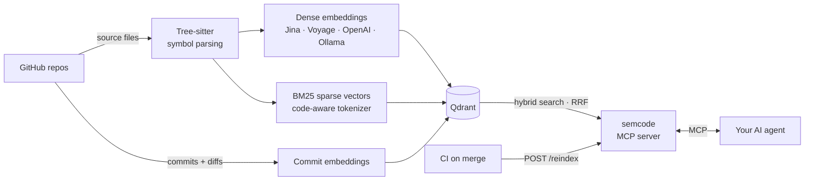

<div align="center">

# semcode

**Hybrid semantic search across all your team's GitHub repos — and their commit history — served to any AI agent over MCP.**

[](https://github.com/GoodbyePlanet/semcode/releases/latest)
[](https://github.com/GoodbyePlanet/semcode/actions/workflows/ci.yml)


[](LICENSE)

[](https://mcpservers.org/servers/goodbyeplanet/semcode)
[](https://mcpmarket.com/server/semcode)
[](https://mcp.so/servers/semcode)

[Quick start](#-quick-start) · [Features](#-features) · [MCP tools](#-mcp-tools) · [Docs](https://goodbyeplanet.github.io/semcode/) · [Blog](blog.md)

</div>

## Why semcode

Coding agents are good at reading the project you have open. They are bad at answering questions that span
the *rest* of your organisation: *"which service publishes `OrderPlaced`?"*, *"how do other teams call the
billing API?"*, *"why did someone change the retry logic last month?"*

|                                         | Without semcode                             | With semcode                                               |
|-----------------------------------------|---------------------------------------------|------------------------------------------------------------|
| Code in other repos                     | Clone it, or paste it into the chat         | One `search_code` call across every indexed repo           |
| "Where is `PlaceOrderRequest` defined?" | grep — if the repo happens to be checked out | Exact or partial symbol-name lookup                        |
| "Where do we publish order events?"     | Guess the right keywords                    | Natural-language search (dense + BM25, fused with RRF)     |
| "Why did this change?"                  | `git log`, repo by repo                     | Semantic search over commit messages, with full diffs      |
| Where your code goes                    | —                                           | Nowhere — self-hosted, with local Jina or Ollama embeddings |

## How it works



semcode fetches files from GitHub, splits them into symbols (functions, classes, methods, components) with
Tree-sitter, and stores two vectors per symbol in Qdrant: a dense semantic embedding and a BM25 vector over
code-identifier subwords (`getUserById` → `get`, `user`, `by`, `id`). Queries run both and fuse the rankings with
Reciprocal Rank Fusion, so natural language *and* exact symbol names work. Indexing is incremental — unchanged
files are skipped by Git blob SHA, and deleted files are cleaned up.

→ Deep dive: [ingestion](https://goodbyeplanet.github.io/semcode/ingestion) ·
[dense vectors](https://goodbyeplanet.github.io/semcode/dense-vectors) ·
[sparse vectors](https://goodbyeplanet.github.io/semcode/sparse-vectors) ·
[retrieval with RRF](https://goodbyeplanet.github.io/semcode/retrieval-rrf) ·
[the blog post](blog.md)

## 🚀 Quick start

**You need:** Docker, and a GitHub token with `Contents: read` on the repos you want indexed.

**1. Start semcode, Qdrant and a local embedding model** (no API key needed):

```bash
git clone https://github.com/GoodbyePlanet/semcode && cd semcode
cp .env.example .env          # then set GITHUB_TOKEN in .env
make docker-up-jina
```

**2. Index a repo:**

```bash
curl -N -X POST http://localhost:8090/reindex \
  -H 'Content-Type: application/json' \
  -d '{"service": "my-service", "github_repo": "owner/repo"}'
```

Progress streams back as NDJSON and ends with `{"type": "done", ...}`. The repo stays registered, so later
reindexes are incremental.

**3. Connect your agent:**

```bash
claude mcp add --transport http semcode http://localhost:8090/mcp
```

That's it. Prefer a hosted embedding provider (Voyage, OpenAI, Jina API) or Ollama? Set `EMBEDDINGS_PROVIDER`
in `.env` and run `make docker-up` instead. Want a curated list of repos in a `config.yaml`, or to run without
Docker? See [Deployment](https://goodbyeplanet.github.io/semcode/deployment).

## 💬 Using it

Ask your agent in plain English:

1. *"Index `acme/payments` with semcode."*
2. *"Where do we publish order events?"*
3. *"Find everything that uses `PlaceOrderRequest`, across all services."*
4. *"Search the commit history: who changed the retry logic in payments, and why?"*
5. Run the **`system_design_overview`** prompt for a full architecture write-up with Mermaid diagrams.

## ✨ Features

- **Many repos, one index.** List services in `config.yaml`, or let each repo register itself from CI with the
  [drop-in GitHub Actions workflow](examples/github-actions/reindex-on-merge.yml).
- **Hybrid retrieval.** Dense embeddings plus BM25 with a camelCase/snake_case-aware tokenizer, fused with RRF.
- **Commit history.** Commit messages and changed files are searchable; full diffs are one tool call away.
- **25 languages and file formats, framework-aware.** Go, Java, Python, TypeScript/JavaScript, Rust, C#, C, C++,
  Ruby, PHP, Kotlin, Scala, Swift, Dart, Bash, SQL, Lua, R, Dockerfile, Docker Compose, Markdown, JSON, HTML,
  CSS, XML. Parsers extract Spring stereotypes and HTTP routes, FastAPI/Pydantic, ASP.NET, Rails,
  Laravel/Symfony, React/SwiftUI/Flutter widgets and more.
- **Pluggable embeddings.** Jina (local TEI or hosted API), Voyage, OpenAI or Ollama.
- **CI-friendly.** Streaming NDJSON [reindex endpoints](https://goodbyeplanet.github.io/semcode/http-api) for
  pipelines and schedulers.
- **GitHub Enterprise Server** support via `GITHUB_API_URL`.

## 🛠 MCP tools

| Tool                    | What it does                                                                       |
|-------------------------|------------------------------------------------------------------------------------|
| `search_code`           | Hybrid search, filterable by language, service and symbol type                     |
| `find_symbol`           | Look up a symbol by exact name, or by case-insensitive token match (`exact=false`) |
| `find_usages`           | Find code that references a symbol                                                 |
| `get_code_context`      | Fetch the full source of a file, or one symbol in it, from GitHub                  |
| `search_commits`        | Natural-language search over commit history                                        |
| `get_commit`            | Full details of a commit, including changed files and diffs                        |
| `reindex`               | Index one or all services (incremental by default; `force` to re-embed)            |
| `index_history`         | Index git commit history                                                           |
| `list_indexed_services` | Indexed services with file/chunk counts, languages and last-indexed time           |
| `index_stats`           | Qdrant collection statistics and configured services                               |

**Prompts:** `service_overview(service)` walks the agent through an architectural overview of one service —
HTTP entry points, domain types, framework conventions. `system_design_overview` does the whole system: service
inventory, communication topology, shared data stores and cross-cutting concerns, with Mermaid diagrams.

## 🔌 Connecting other clients

The server speaks streamable HTTP at `http://localhost:8090/mcp`.

<details>
<summary><b>VS Code</b></summary>

Add to `.vscode/mcp.json`:

```json
{
  "servers": {
    "semcode": { "type": "http", "url": "http://localhost:8090/mcp" }
  }
}
```

Or from the command line:

```bash
code --add-mcp '{"name":"semcode","type":"http","url":"http://localhost:8090/mcp"}'
```

</details>

<details>
<summary><b>Codex CLI</b></summary>

Add to `~/.codex/config.toml`:

```toml
[mcp_servers.semcode]
url = "http://localhost:8090/mcp"
```

</details>

<details>
<summary><b>Other MCP clients</b> (Cursor, Windsurf, …)</summary>

Add an entry to the client's MCP config:

```json
{
  "mcpServers": {
    "semcode": { "transport": "http", "url": "http://localhost:8090/mcp" }
  }
}
```

</details>

<details>
<summary><b>stdio</b> — the client spawns the server</summary>

Needs Qdrant reachable (e.g. `docker compose up -d qdrant`) and dependencies installed (`uv sync`).
`GITHUB_TOKEN`, `QDRANT_URL` and the embedding variables are still read from `.env` in the project directory.

```bash
claude mcp add semcode --transport stdio --env MCP_TRANSPORT=stdio \
  -- uv run --directory /path/to/semcode python -m server.main
```

```json
{
  "mcpServers": {
    "semcode": {
      "command": "uv",
      "args": ["run", "--directory", "/path/to/semcode", "python", "-m", "server.main"],
      "env": { "MCP_TRANSPORT": "stdio" }
    }
  }
}
```

</details>

<details>
<summary><b>SSE</b> — legacy transport</summary>

Only for clients that don't support streamable HTTP yet. Set `MCP_TRANSPORT=sse` in `.env`, start the server as
usual, and point the client at `http://localhost:8090/sse`:

```bash
claude mcp add --transport sse semcode http://localhost:8090/sse
```

</details>

## ⚖️ How it compares

|                | semcode                    | [claude-context](https://github.com/zilliztech/claude-context) | [Serena](https://github.com/oraios/serena) | grep / file reads |
|----------------|----------------------------|----------------------------------------------------------------|--------------------------------------------|-------------------|
| Scope          | Many remote GitHub repos   | Local codebase                                                 | Local project                              | Local checkout    |
| Search         | Hybrid (dense + BM25, RRF) | Hybrid (dense + BM25)                                          | Symbol-level, via language servers         | Exact text        |
| Commit history | ✅ semantic search + diffs | —                                                              | —                                          | `git log`         |
| Deployment     | Shared team service        | Per developer                                                  | Per developer                              | —                 |
| Needs an index | Yes (Qdrant)               | Yes (Milvus / Zilliz Cloud)                                    | No                                         | No                |

**When semcode doesn't help:** a single small repo you already have open — your agent can read it directly, and
editing-oriented tools like Serena are a better fit there. semcode pays off when the answer lives in code you
*don't* have checked out.

## 📚 Documentation

The [docs site](https://goodbyeplanet.github.io/semcode/) covers everything this page leaves out:

- [Deployment](https://goodbyeplanet.github.io/semcode/deployment) — Docker services, embedding paths, `config.yaml`, transports
- [Configuration](https://goodbyeplanet.github.io/semcode/configuration) — every environment variable and embedding provider setting
- [HTTP API](https://goodbyeplanet.github.io/semcode/http-api) — `/reindex`, `/reindex-history`, NDJSON frame shapes
- [Qdrant collections](https://goodbyeplanet.github.io/semcode/qdrant-collections) — vectors, HNSW settings, payload fields
- [Ingestion](https://goodbyeplanet.github.io/semcode/ingestion) and [retrieval with RRF](https://goodbyeplanet.github.io/semcode/retrieval-rrf) — how it works inside
- [Changelog](CHANGELOG.md) — release history, generated from commit messages

## 🤝 Contributing

Contributions are welcome! See [CONTRIBUTING.md](CONTRIBUTING.md) for dev setup, tests, adding a language parser,
and the Conventional Commits rules that drive releases.

## License

[MIT](LICENSE)
